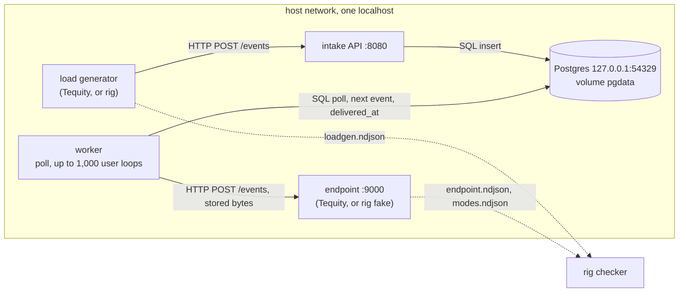
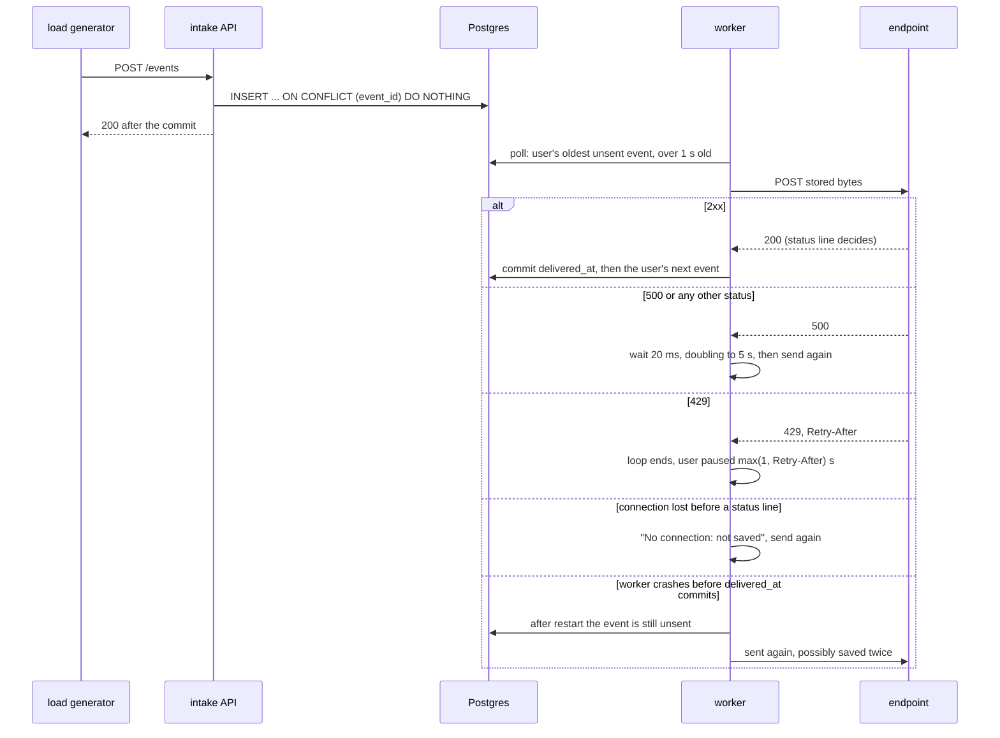

# Architecture

It follows docs/decisions.md; brackets start each governing entry's title.

## Parts

Every container uses host networking, so they share one localhost. In tests, rig/compose.yaml stands in for both Tequity parts.



## Life of one event

1. Receive. Over 1 MB: 413. Not a JSON object, or event_id, user_id or created_at missing, not a non-empty string, or created_at failing the RFC 3339 pattern: 400, logged. Fraction past 6 decimals cut and logged. [Intake answers 200] [created_at stays a string]
2. Insert, `ON CONFLICT (event_id) DO NOTHING`. Cast refused: 400. Repeat: 200, first body kept, a different body logged. Other database error: 503. Crash before commit: no answer, no promise. [event_id is the primary key] [A database error or a failed loop]
3. Answer 200 after the commit.
4. Poll, 200 ms after the last finished: users whose oldest unsent event (created_at, seq) arrived over 1 s ago, not in flight or paused, longest-waiting first. [The poll picks]
5. Loop, one per user. Before each send it looks up the oldest unsent event again; if held, or none is left, the loop ends and frees its slot. [A user waits]
6. Send with `http.request`, no timeout. Every response drained. [A send has no overall time limit] [The status line decides]
   - 2xx: saved, go to 7.
   - Any other status, refused connect, or connection lost before a status line: wait 20 ms doubling to 5 s inside the loop, keeping the slot, then back to 5. [Any 2xx means saved]
   - 429: the loop ends; the user is paused max(1, Retry-After) s. [A 429 pauses]
7. Commit `delivered_at`, retrying only the write with the same waits, inside the send step so its errors never reach the loop's catch; then back to 5. [delivered_at is committed]
8. Crash or kill during 6 or 7: the event is resent on restart, possibly saved twice. SIGTERM: no new sends, in-flight sends and writes finish, compose kills at 120 s. [A normal stop]
9. Restart: both processes retry Postgres until it answers. [Startup waits]



## Files

```
compose.yaml  Dockerfile  package.json  package-lock.json  tsconfig.json
db/init.sql          events table and index
src/db.ts            Pool with error handler, connect retry
src/intake.ts        validate(buf) -> {ok,fields} | {status,reason}; insert(pool,buf,fields) -> status
src/api.ts           HTTP server :8080, keepAliveTimeout 65 s, SIGTERM
src/send.ts          post(agent,url,buf,ids) -> {kind:"saved"} | {kind:"pause",seconds} | {kind:"retry",why}
src/sql.ts           readyUsers(pool,excluded,limit), oldestUnsent(pool,user,lastDelivered), markDelivered(pool,id) -> boolean
src/worker.ts        poll, user loops, waits, SIGTERM; nextWait(failures) pure
test/*.test.ts       node --test and tsc --noEmit, one file per src file
rig/compose.yaml  rig/Dockerfile
rig/types.ts (log lines, scenario)  rig/rng.ts  rig/endpoint.ts  rig/loadgen.ts  rig/check.ts
rig/scenarios/*.json  rig/baseline.json
```

## Contracts

`events`: `event_id text PRIMARY KEY`, `user_id text NOT NULL`, `created_at timestamptz NOT NULL`, `body bytea NOT NULL`, `received_at timestamptz NOT NULL DEFAULT now()`, `seq bigint GENERATED ALWAYS AS IDENTITY`, `delivered_at timestamptz`, and the `events_pending` index.

Intake: `POST /events` only; anything else 404. Worker to endpoint: `POST /events`, stored bytes, `Content-Type: application/json`.

Rig, NDJSON, times in epoch milliseconds:
- `loadgen.ndjson`: `t_send, t_done, event_id, user_id, created_at, body_sha256, valid, status` (null plus `err` when unanswered).
- `endpoint.ndjson`: `t, event_id, user_id, created_at, body_sha256, mode, status, saved`.
- `modes.ndjson`: `t, mode, users` on every change, including `relay_stopped` while a scenario stops our services.
- Scenario: one seeded JSON file holding the load and timed endpoint steps; plan.md defines every field.
- `check.ts` prints one JSON line per check, `{check, pass, detail}`, and exits 0 only if all pass.
